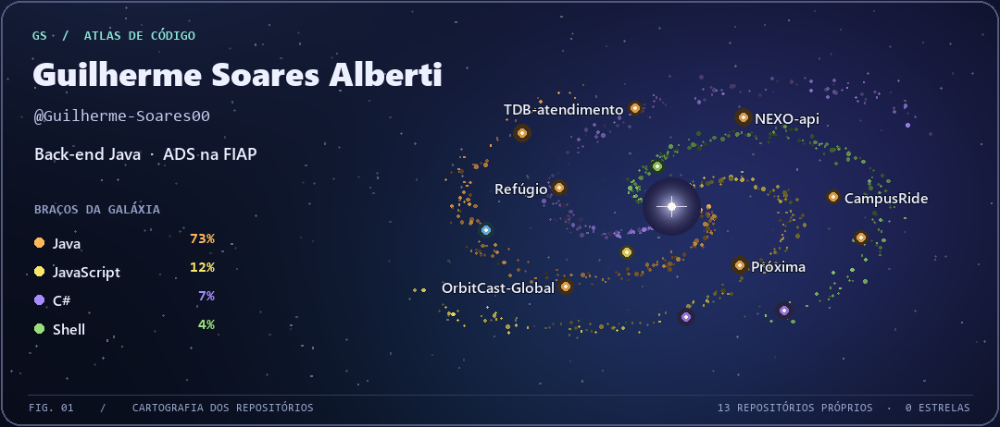
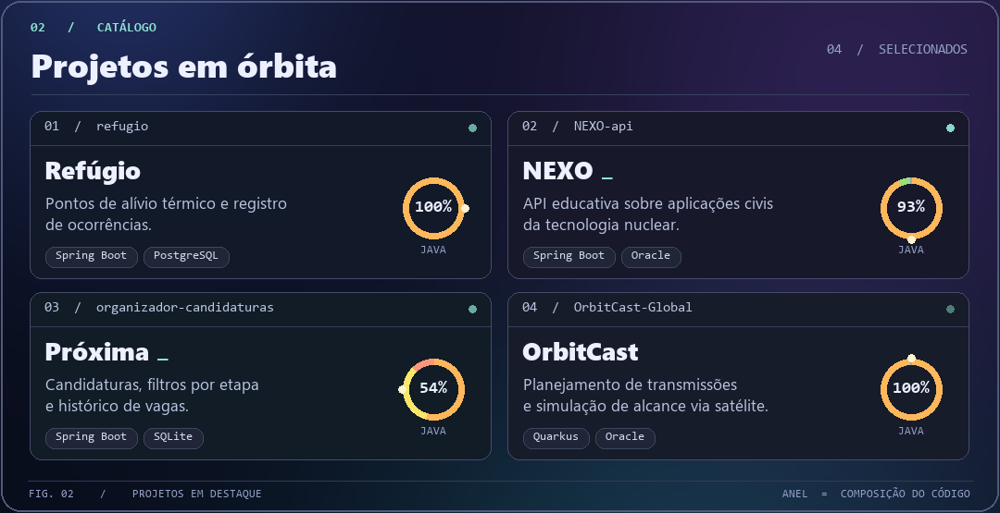
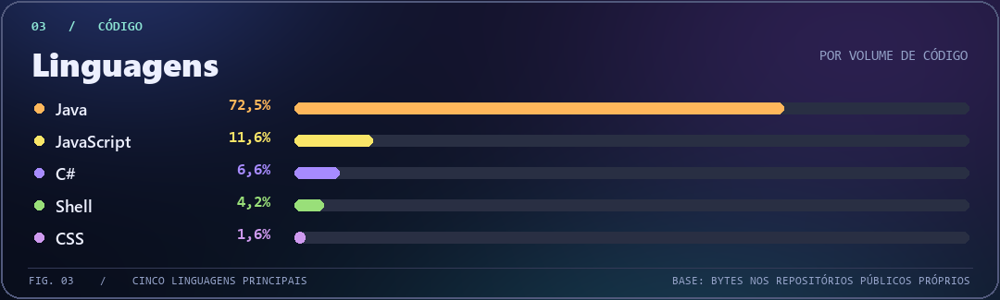

[Ver versão animada](README.md)

Estudo **Análise e Desenvolvimento de Sistemas na FIAP** e desenvolvo APIs REST com **Java, Spring Boot e Quarkus**. Busco uma oportunidade de estágio ou uma vaga júnior em back-end.

[Refúgio](https://github.com/Guilherme-Soares00/refugio) · [NEXO](https://github.com/Guilherme-Soares00/NEXO-api) · [Próxima](https://github.com/Guilherme-Soares00/organizador-candidaturas) · [OrbitCast](https://github.com/Guilherme-Soares00/OrbitCast-Global)

**Contato**  ·  [LinkedIn](https://www.linkedin.com/in/guilherme-soares-alberti)  ·  [Todos os repositórios](https://github.com/Guilherme-Soares00?tab=repositories)
