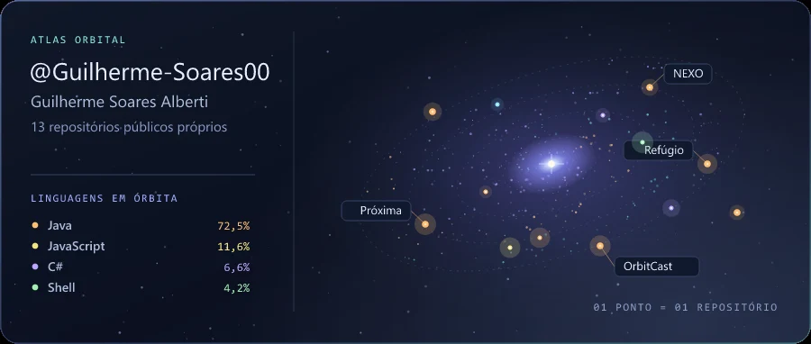
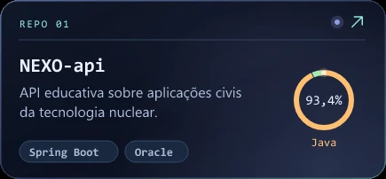
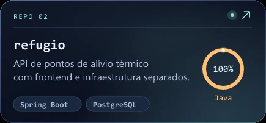
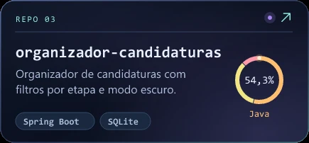
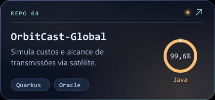
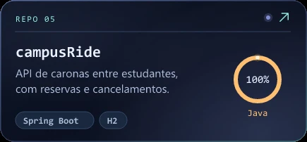
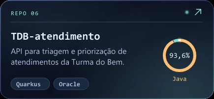
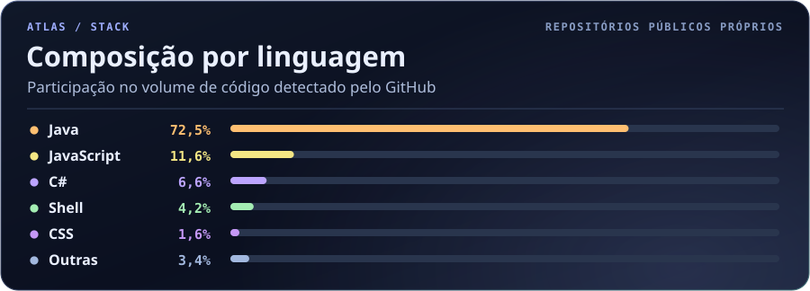

  <picture>
    <source media="(prefers-reduced-motion: reduce)" srcset="assets/galaxia-estatica.svg" />
    
  </picture>

Estudo **Análise e Desenvolvimento de Sistemas na FIAP** e desenvolvo **APIs REST em Java**, principalmente com Spring Boot, Quarkus e bancos relacionais. Busco uma oportunidade de estágio ou uma vaga júnior em back-end.

## Projetos em destaque

  <a href="https://github.com/Guilherme-Soares00/NEXO-api"><picture><source media="(prefers-reduced-motion: reduce)" srcset="assets/NEXO-api.svg" /></picture></a>
  <a href="https://github.com/Guilherme-Soares00/refugio"><picture><source media="(prefers-reduced-motion: reduce)" srcset="assets/refugio.svg" /></picture></a>

  <a href="https://github.com/Guilherme-Soares00/organizador-candidaturas"><picture><source media="(prefers-reduced-motion: reduce)" srcset="assets/organizador-candidaturas.svg" /></picture></a>
  <a href="https://github.com/Guilherme-Soares00/OrbitCast-Global"><picture><source media="(prefers-reduced-motion: reduce)" srcset="assets/OrbitCast-Global.svg" /></picture></a>

  <a href="https://github.com/Guilherme-Soares00/campusRide"><picture><source media="(prefers-reduced-motion: reduce)" srcset="assets/campusRide.svg" /></picture></a>
  <a href="https://github.com/Guilherme-Soares00/TDB-atendimento"><picture><source media="(prefers-reduced-motion: reduce)" srcset="assets/TDB-atendimento.svg" /></picture></a>

## Linguagens

**Stack de back-end:** Java, Spring Boot, Quarkus e SQL. **Ferramentas:** Git, Docker, Maven, Gradle e Swagger/OpenAPI.

## Contato

  
  

